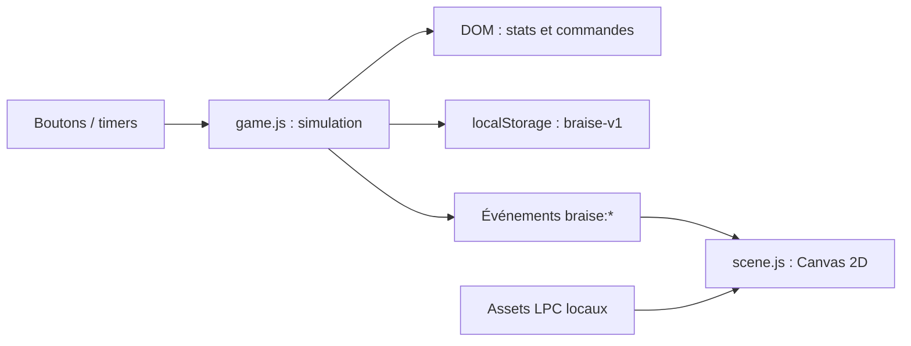

# Architecture actuelle

## Carte des fichiers

| Chemin | Responsabilité |
| --- | --- |
| `dist/index.html` | Structure, contrôles, HUD, fenêtre de retour et chargement des modules. |
| `dist/style.css` | Palette, panneaux, responsive et préférences de mouvement. |
| `dist/game.js` | État, sauvegarde, combat, gains, améliorations, événements et mise à jour du DOM. |
| `dist/scene.js` | Chargement des sprites, décor précalculé, horloge visuelle et rendu Canvas. |
| `dist/credits.html` | Crédits accessibles aux joueurs. |
| `dist/assets/lpc/` | Couches, sprites composés, décors, sources et licences LPC. |
| `dist/assets/Tiles/` | Pack Kenney du prototype, dont les icônes d’amélioration encore utilisées. |
| `tools/` | Contrôles locaux et scripts de récupération/composition des sprites. |
| `.openai/hosting.json` | Identité du Site existant et répertoire statique `dist`. Aucun secret. |

## Flux

La simulation avance par timers, le rendu par `requestAnimationFrame`. La scène ne modifie pas l’or, l’expérience ou les points de vie. La pause arrête les attaques et l’horloge visuelle. L’onglet masqué peut subir la limitation des timers du navigateur ; une gestion d’absence uniforme fait partie de M1.

## Contrat des événements

| Événement | Données | Utilisation |
| --- | --- | --- |
| `braise:combat` | `damage`, `strong`, `defeated`, `boss`, `health` | Lance une séquence visuelle. `health` est actuellement la fraction de vitalité au début de la résolution. |
| `braise:spawn` | `boss` | Signale le nouvel adversaire. |
| `braise:pause` | booléen | Fige/reprend l’horloge visuelle. |

Limite : le moteur applique le résultat immédiatement, puis l’animation montre le coup. Un `spawn` peut donc suivre le coup fatal avant la fin de la chute. Les listeners de scène sont installés après chargement des images, et les premiers événements peuvent être manqués. M1 prévoit une initialisation et un contrat d’état explicites.

## Sprites et directions

Frames de 64 × 64 px. Le héros utilise des feuilles distinctes pour marche, coup et chute ; le gobelin regroupe ses actions dans `goblin-sword.png`.

| Planche | Direction/action | Ligne (index 0) |
| --- | --- | --- |
| `hero-walk.png`, `hero-swing.png` | Est, face au gobelin | 3 |
| `goblin-sword.png` | Ouest, face au héros | 3 |
| `goblin-sword.png` | Est, dos au héros | 1 |
| `goblin-sword.png` | Chute | 4 |

Les noms `HERO_ROWS` et `GOBLIN_ROWS` rendent ces différences explicites dans `scene.js`. Ne pas appliquer un mapping universel LPC.

## Sauvegarde

Clé actuelle : `braise-v1`. Champs : `gold`, `xp`, `level`, `stage`, `kills`, `weapon`, `armor`, `luck`, `last` (timestamp en millisecondes). Vitalité, ennemi, recharge et pause ne sont pas persistés. Un rechargement restaure donc la vitalité et l’adversaire.

Le chargement combine valeurs par défaut et JSON ; seule la validité minimale de l’étage est contrôlée. Les autres champs, les migrations, le comportement en stockage indisponible et les nombres non finis nécessitent le durcissement prévu en M1. Ne pas simplement changer le nom de clé pour contourner ce travail.

## Évolution prévue

Extraire d’abord une logique pure testable : état, règles de combat, économie, sérialisation et migrations. Conserver une application statique tant qu’aucun besoin ne justifie un serveur. Décider d’une bibliothèque de rendu ou d’un framework seulement après une mesure concrète des limites du Canvas actuel.
