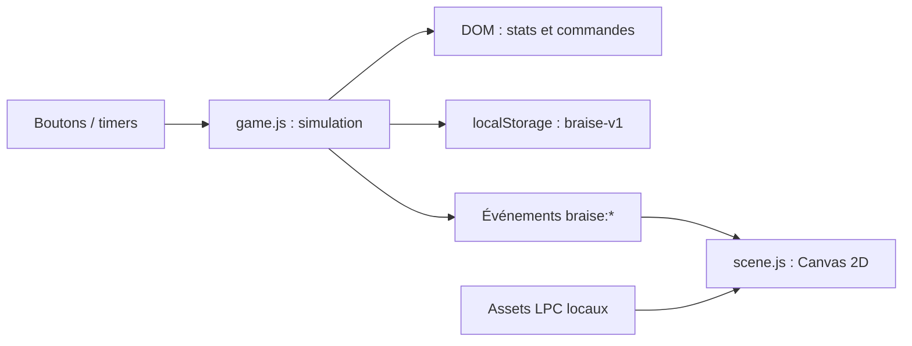

# Architecture actuelle

## Carte des fichiers

| Chemin | Responsabilité |
| --- | --- |
| `dist/index.html` | Structure, contrôles, HUD, fenêtre de retour et chargement des modules. |
| `dist/style.css` | Palette, panneaux, responsive et préférences de mouvement. |
| `dist/game.js` | État, sauvegarde, combat, gains, améliorations, événements et mise à jour du DOM. |
| `dist/engine/audio.js` | Réglages audio purs (muet, volume borné, `peutJouer`) et registre `jouer(nom)`. Web Audio est branché dans `dist/game.js`, après la première interaction. |
| `dist/engine/affichage.js` | Réglages d'affichage purs (mouvement `systeme`/`reduit`/`complet`, effets `actifs`/`discrets`) et `mouvementReduit(reglage, prefereSysteme)`. |
| `dist/engine/sons.js` | Recettes pures des sons synthétisés (`coup`, `coup-gardien`, `feu`, `pas`) et `sonsPourEvenement` ; la scène planifie les sons sur son horloge et émet `braise:son`, `game.js` les lit en Web Audio (oscillateurs, bruit blanc). Aucun fichier audio. |
| `dist/scene.js` | Chargement des sprites, décor précalculé, horloge visuelle et rendu Canvas. |
| `dist/credits.html` | Crédits accessibles aux joueurs. |
| `dist/assets/lpc/` | Couches, sprites composés, décors, sources et licences LPC. |
| `dist/assets/Tiles/` | Trois icônes Kenney (CC0) des améliorations ; le reste du pack a été retiré. |
| `tools/assets-manifest.json` | Manifeste des PNG de `dist/assets/` : `chemin`, `source` (LPC + commit amont figé, dérivé `compose-hero.py` ou Kenney), `licence`, `sha256`. Régénéré par `python3 tools/build-assets-manifest.py` ; `tools/check.mjs` le contrôle hors ligne. |
| `tools/` | Contrôles locaux et scripts de récupération/composition des sprites. |
| `.openai/hosting.json` | Identité du Site existant et répertoire statique `dist`. Aucun secret. |

## Flux

La simulation avance par timers, le rendu par `requestAnimationFrame`. La scène ne modifie pas l’or, l’expérience ou les points de vie. La pause arrête les attaques et l’horloge visuelle. L’onglet masqué peut subir la limitation des timers du navigateur ; une gestion d’absence uniforme fait partie de M1.

## Contrat des événements

| Événement | Données | Utilisation |
| --- | --- | --- |
| `braise:combat` | `damage`, `strong`, `defeated`, `boss`, `health` | Lance une séquence visuelle. `health` est actuellement la fraction de vitalité au début de la résolution. |
| `braise:spawn` | `boss` | Signale le nouvel adversaire. |
| `braise:pause` | booléen | Fige/reprend l’horloge visuelle. |

Le moteur applique le résultat immédiatement ; la scène rejoue `combat` et `spawn` via une file (`dist/engine/scene-queue.js`) tamponnée jusqu'à la fin du chargement des images, puis séquencée coup → chute → entrée suivante. `game.js` garde les événements émis avant l'installation des listeners dans `window.braiseBacklog`, que la scène rejoue. `braise:pause` s'applique immédiatement. Les étincelles en vol sont plafonnées (`ETINCELLES_MAX`, `dist/engine/etincelles.js`) et, en pause, la scène dessine une dernière image puis arrête `requestAnimationFrame` jusqu'à la reprise ou au prochain événement. Limite : la barre de vie DOM de l'ennemi reste mise à jour sans attendre la chute.

## Sprites et directions

Frames de 64 × 64 px. Le héros de la scène est composé hors écran à partir des couches LPC selon `s.equipe` : `dist/engine/apparence-heros.js` donne l'ordre `body, pants, boots, mail, [plate], hood` puis `[sword]` en `swing` seulement (comme `tools/compose-hero.py`). `dist/game.js` émet `braise:equipement` (`{ arme, armure }`) au chargement et à chaque changement ; `dist/scene.js` recompose une fois par changement, pas à chaque image. Le **charme** n'a pas de couche LPC dans le dépôt : aucun changement visuel. `hero-*.png` et `portrait.png` restent (portrait de l'interface). Les planches `*-swing` des couches font 7 colonnes : seules les 6 premières sont utilisées. Le héros utilise des feuilles distinctes pour marche, coup et chute ; le gobelin regroupe ses actions dans `goblin-sword.png`.

| Planche | Direction/action | Ligne (index 0) |
| --- | --- | --- |
| `hero-walk.png`, `hero-swing.png` | Est, face au gobelin | 3 |
| `body-*`, `pants-*`, `boots-*`, `mail-*`, `plate-*`, `hood-*` (`walk`, `swing`, `hurt`), `sword.png` | Est, face au gobelin (même planche que le héros) | 3 |
| `goblin-sword.png` | Ouest, face au héros | 3 |
| `goblin-sword.png` | Est, dos au héros | 1 |
| `goblin-sword.png` | Chute | 4 |

Les noms `HERO_ROWS` et `GOBLIN_ROWS` rendent ces différences explicites dans `scene.js`. Ne pas appliquer un mapping universel LPC.

## Sauvegarde

Clé actuelle : `braise-v2` (JSON avec `version: 3`). `braise-v1` (sans champ `version`) est migrée par `migrate` au premier chargement puis conservée comme secours, jamais réécrite. « Exporter » / « Importer » (pied de page) passent par `serializeSave` / `importSave`, donc `parseSave`. Champs : `gold`, `xp`, `level`, `stage`, `kills`, `weapon`, `armor`, `luck`, `last` (timestamp en millisecondes), `inventaire` (24 objets au plus) et `equipe` (un objet par emplacement). v1 et v2 sont migrées vers v3 avec inventaire et équipement vides. Vitalité, ennemi, recharge et pause ne sont pas persistés. Un rechargement restaure donc la vitalité et l’adversaire.

Le chargement combine valeurs par défaut et JSON ; seule la validité minimale de l’étage est contrôlée. Les autres champs, les migrations, le comportement en stockage indisponible et les nombres non finis nécessitent le durcissement prévu en M1. Ne pas simplement changer le nom de clé pour contourner ce travail.

Champ optionnel `audio: { muet, volume }` (volume dans [0, 1]) : absent → défaut (son actif, 60 %) sans réparation ; invalide → défaut et statut `repaired`, le reste de la partie est conservé. `SAVE_VERSION` reste 2.

Champ optionnel `affichage: { mouvement, effets, texte }` (`mouvement` : `systeme` | `reduit` | `complet`, `effets` : `actifs` | `discrets`, `texte` : `normal` | `grand`, ≈ 125 %, via `--texte` sur `:root` et les tailles de police en `rem`) : absent → `systeme` / `actifs` / `normal` sans réparation (une sauvegarde sans `texte` reste valide, `SAVE_VERSION` inchangé) ; `texte` invalide → `normal` et `repaired`, les deux autres réglages valides conservés ; ensemble invalide → défaut et statut `repaired`, le reste de la partie est conservé. Règles pures dans `dist/engine/affichage.js` ; `game.js` les transmet à la scène par `braise:affichage`.

## Évolution prévue

Extraire d’abord une logique pure testable : état, règles de combat, économie, sérialisation et migrations. Conserver une application statique tant qu’aucun besoin ne justifie un serveur. Décider d’une bibliothèque de rendu ou d’un framework seulement après une mesure concrète des limites du Canvas actuel.
